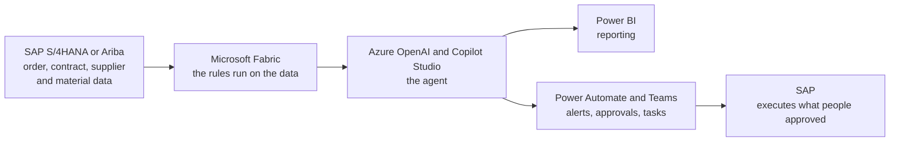

# Data Quality Agent

**Procurement data quality.** An AI agent that finds missing and contradictory procurement data, works out the root cause, who has to act and what it costs, and proposes costed ways to fix it for a person to decide.

Fictional company, no client data. You are interacting with an AI system: every action it prepares is a draft that waits for human approval, and nothing is ever sent.

> **Status: version 0.2.0, the second of three milestones.** The agent runs, in Simulation and Live mode, on the board it reads and marks. Hardening, exports and the release follow in 1.0. [PLAN.md](PLAN.md) is the build plan; [REVIEW.md](REVIEW.md) says what each milestone delivers.

Live site: <https://victorpflueger.github.io/PROC-data-quality/> (GitHub Pages, from `main`).

## What it does

GlobalCorp SE is the fictional industrial group of the [Rebate Hunter](https://github.com/VictorPflueger/PROC-Rebate-Hunter). Fifteen deterministic rules check its purchase-order lines, contracts, supplier and material master data over five data-quality dimensions: completeness, consistency, validity, uniqueness and timeliness. Accuracy is left out on purpose, because whether a value matches reality needs an outside check. Each exception is routed to the person who can fix it, its spend and financing cost are worked out, and it counts as closed only when a re-scan no longer finds it.

The agent reads the records behind the findings, groups them by their root cause, lets the engine cost two or three fix paths next to doing nothing, waits for a decision and drafts the follow-ups and change requests. Two modes, chosen when a run starts: **Simulation** replays scripted runs offline and needs no key; **Live** runs the agent with your own Claude API key, kept for the browser tab only.

## What version 0.2.0 shows

- **Six scenarios**, each a root cause planted in the data and a short, unverified tip; **Live sweep** (scan every rule, investigate the first case) and **Custom what-if** (any tip in your words) in Live mode. **Start agent** asks for the mode.
- **The agent's run** in the console: a plain sentence above every tool call with the call itself one click away, the hypothesis and its visible revision, a *Guardrail* line wherever code refuses a step, the verified case card with the records read, and the report. The progress rail turns merlot when the agent needs you: *Your confirmation* of AI-suggested material groups, *Your decision* on a fix path, *Your approval* of each draft.
- **The data-quality board:** a honeycomb of the fifteen rules by data product, each cell in its state with a mark (a cross for a high-severity rule with open exceptions, a bar and dot for a medium or low one, a tick for none) and its exceptions one click away; the people the exceptions are routed to; and the eight weekly closure cohorts as a chart with their numbers one click away. What the agent reads pulses in fjord.
- **The drawer:** the fix-path cards with the engine's figures (exceptions closed, spend covered, financing cost avoided now, exceptions prevented and future cost avoided a year, one-off effort and days, the closure rate projected after re-scan) next to doing nothing; the outbox ("Draft. Nothing is sent."); and the audit log, exported as JSON. An approved fix reads *approved, re-scan pending*: only a re-scan that no longer finds an exception closes it.
- **Save run as simulation** after a live run of a scenario: the run becomes a script with placeholders for the engine's figures, checked against the live guardrails before it is offered.
- **How it works**, with the production path, and **Diagnostics**, which checks the API, the security policy, the key handling, the world's data and every simulation script in your browser.

Every figure on the page comes from the engine: `js/engine.js` (the rules, routing, clean spend, financing cost), `js/history.js` (the closure rate, cohorts, reconciliation with the log, projections), `js/fixpaths.js` (the fix paths and doing nothing), `js/figures.js` (the audit that keeps every figure the agent writes traceable) and `js/vat.js` (the VAT format rule). The agent reaches them only through its seventeen tools (`js/tools.js`), which hold its guardrails; the simulation player and the script checker run through the same tools, so a replay obeys the same rules as a live run. The same modules run in the browser and under Node, where the golden cases test them.

## Live mode and your key

Live mode runs on your own Anthropic API key. It is asked for only when a live run starts, checked with Anthropic's free model list, kept in this tab's session storage under `dq.anthropic.key` and sent only to `api.anthropic.com`; it never reaches local storage, the audit export, a recording or the console, and **Forget key** removes it. Use a key of its own with a low monthly spend limit. A run stops at 40 model calls or €3, whichever comes first, and the cost meter shows the spend as it goes (1 USD = 0.894 EUR).

## The production path

In a production landscape the same steps would run on these products; the prototype stands in for all of them in one browser page.



## Run it

Open the live site, or serve this folder with any static web server and open it in a current Chrome or Edge:

```
python -m http.server 8000
```

then `http://localhost:8000`. Browsers block the page's modules when `index.html` is opened straight from disk; the loading screen says so. Nothing is installed and nothing is built: the page is HTML, CSS and JavaScript modules, and its data ship as four script files in `data/`.

The world is generated by `node tools/build_world.mjs` (seed 1911, the same bytes on every run). `node tools/check_world.mjs` checks it and plays every simulation script of `data/sim_runs.js` through the live tools along each decision path; run it before a demo.

## Tests

`node tests/run-all.mjs` runs every suite; [tests/README.md](tests/README.md) lists them and how to set up Playwright for the browser suites. GitHub Actions runs them on every push and pull request. No test calls a real API.

## Documents

- [TECH_NOTES.md](TECH_NOTES.md): verified facts with their dates, the security policy and storage, how the engine reads the method, the world's calibration, the agent's guardrails, the simulation format, decisions and open points, the verification log and the acceptance checklist.
- [DATA_SOURCES.md](DATA_SOURCES.md): where every value comes from, the VAT formats and check-digit rules with their sources.
- [DESIGN.md](DESIGN.md): the look on Vici, the colour grammar, the board's states and the checks behind them.
- [REVIEW.md](REVIEW.md): what was asked and built, and the shared shell.
- [PLAN.md](PLAN.md): the build plan.

## Sister prototypes

Built on the same shell and on [Vici](https://github.com/VictorPflueger/ViciDesign), Victor Pflüger's design system: [Rebate Hunter](https://github.com/VictorPflueger/PROC-Rebate-Hunter), [Navigator](https://github.com/VictorPflueger/supply-chain-navigator), [Timetable Translator](https://github.com/VictorPflueger/physicalAI-scheduler) and [Repack Pilot](https://github.com/VictorPflueger/physicalAI-repacking).
