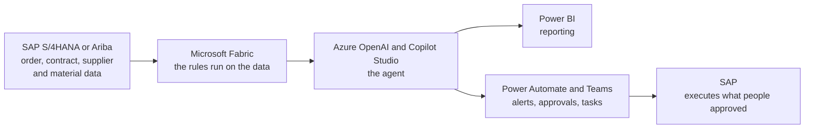

# Data Quality Agent

**Procurement data quality.** An AI agent that finds missing and contradictory procurement data, works out the root cause, who has to act and what it costs, and proposes costed ways to fix it for a person to decide.

Fictional company, no client data. You are interacting with an AI system: every action it prepares is a draft that waits for human approval, and nothing is ever sent.

> **Status: version 1.0.0, the release.** Six scenarios in Simulation and Live mode, the exports, the Method dialog with the method's parameters, layout, design and accessibility tests, the documents and an independent review. [REVIEW.md](REVIEW.md) says what each milestone delivered; [PLAN.md](PLAN.md) is the build plan.

Live site: <https://victorpflueger.github.io/PROC-data-quality/> (GitHub Pages, from `main`).

## What it is and why it matters

Procurement reports are only as good as the order, contract, supplier and material records under them. A contract compliance report cannot count an order that lost its contract reference; a spend cube cannot classify a line without a material group; an early payment costs money whenever an order carries shorter payment terms than the contract. A dashboard that turns red tells you *that* something is wrong. It does not tell you which records, who can fix each one, what the problem costs or which fix is worth its effort.

The Data Quality Agent watches the procurement data of **GlobalCorp SE**, the fictional industrial group of the [Rebate Hunter](https://github.com/VictorPflueger/PROC-Rebate-Hunter). Fifteen deterministic rules check its purchase-order lines, contracts, supplier and material master data over five data-quality dimensions: completeness, consistency, validity, uniqueness and timeliness. Accuracy is left out on purpose, because whether a value matches reality needs a check outside the data. Each exception is routed to the person who can fix it, its spend and financing cost are worked out, and it counts as **closed only when a re-scan no longer finds it**.

The agent reads the records behind the findings, groups them by their root cause, lets the engine cost two or three fix paths next to doing nothing, waits for a person's decision and drafts the follow-ups and change requests. Five principles show on screen:

| Principle | Where it shows |
| --- | --- |
| Explain every finding | The case card names the rules, the records read, the order lines, the spend and financing cost, and the person each exception is routed to; every figure on a card, tile or table comes from the engine |
| People decide | Fix paths wait for a decision, every draft for its own approval, AI-suggested values for a review |
| An audit trail by design | The audit log keeps every event with the rule-set and engine versions, the reviewer's decisions and their times, and each draft's disposition; it exports as JSON |
| Track what a fix brings | The value here is closure: detected, routed, fix approved, closed by re-scan. Financing costs show as one-off amounts or a yearly run rate, never as savings |
| Standard data products | Five data products (order lines, contracts, suppliers, materials, users) and the exception log, shaped after SAP's purchasing tables |

## How it works

A run has the same five steps as the intro window and the progress rail:

1. **Spot.** The rules scan the data and reconcile what they find with the exception log.
2. **Check.** The agent reads the records behind the findings, states a hypothesis, revises it when the data disagree, and groups the exceptions by the root cause the data support. It raises a case only when the group is large enough and it has read enough of its records.
3. **Calculate.** The engine works out the case's spend, financing cost, history and who must act, and costs the fix paths.
4. **Propose.** The agent offers two or three costed fix paths next to doing nothing. *Your decision.*
5. **Prepare.** It drafts what the approved path allows: follow-ups to the people the exceptions are routed to, a mock change request, a prevention request, or a memo of the accepted risk. *Your approval* of each draft. Nothing is sent.

Under the page:

- **One engine for every figure.** `js/engine.js` (the rules, routing, clean spend, financing cost), `js/history.js` (the closure rate, cohorts, reconciliation with the log, projections), `js/fixpaths.js` (the fix paths and doing nothing), `js/figures.js` (the audit that keeps every figure the agent writes traceable) and `js/vat.js` (the VAT format rule). The same modules run in the browser and under Node, where the golden cases test them.
- **One toolbox for every producer.** The agent reaches the engine only through its seventeen tools (`js/tools.js`), which hold its guardrails. The simulation player and the script checker run through the same tools, so a replay obeys the same rules as a live run.
- **Guardrails in code, not only in the prompt.** Only the rules find exceptions; a verified case needs a named group of at least half its base and three of its records read; options come only from the latest fix-path calculation; drafts only follow the approved path; every figure in a text must match a figure a tool returned. Where code refuses a step, the console shows a *Guardrail* line with the reason.
- **Browser-enforced boundaries.** The page's security policy lets it connect to api.anthropic.com only and loads nothing from another site; the design system Vici ships in `vici/`.

## The production path

In a production landscape the same steps would run on these products; the prototype stands in for all of them in one browser page.



## Deploy

The page is HTML, CSS and JavaScript modules with its data in four script files: nothing is installed and nothing is built.

1. **GitHub Pages.** In the repository's **Settings → Pages**, choose **Deploy from a branch**, branch **main**, folder **/ (root)**. The hidden file `.nojekyll` keeps GitHub from running Jekyll over the Markdown files. After a minute or two the site is live; the *pages build and deployment* workflow shows the progress, and the *live site* workflow then checks that Pages serves exactly the commit and that a Simulation run completes there (`tests/live_site.mjs`).
2. **Locally.** Browsers block JavaScript modules opened straight from disk, and the loading screen says so. Serve the folder instead, then open `http://localhost:8000`:

```
python -m http.server 8000
```

3. **Updating.** Pages caches files for up to ten minutes. After an update, hard-reload (Ctrl + Shift + R) and check the version at the bottom of Diagnostics.
4. **Before a demo,** open **Diagnostics** on the presentation laptop and network and click **Run all tests**: the Claude API's reachability, the security policy, the key handling, the world's integrity and every simulation script along each decision path.

The world is generated by `node tools/build_world.mjs` (seed 1911, the same bytes on every run). `node tools/check_world.mjs` checks it and plays every simulation script through the live tools along each decision path.

## First visit

On a first visit, **How it works** opens by itself: what the agent does, its five steps, why it pays off and the production path. Its **Start agent** button leads straight into a run. The **How it works** button in the header opens it again at any time; during a run it only explains and never interrupts.

## Reading the screen

- **The header** carries the mode badge (SIMULATION on its striped tape, or LIVE), the theme toggle, *You are interacting with an AI system*, *Fictional company, no client data*, and four tiles: **Closure rate** (the primary KPI; after an approval, the projection after re-scan in its second line), **Clean spend** (the share, with the euros below), **Open exceptions** (with the spend of their order lines below) and **Session cost**.
- **The data-quality board** shows the fifteen rules as a honeycomb of hexagon cells grouped by data product. A cell shows its rule, a short name and its open exceptions, and takes its state with a mark: a cross on danger red for a high-severity rule with open exceptions, a bar and dot on warning honey for a medium or low one, a tick on success green for a rule with nothing open, neutral before the first scan. A click opens the rule's exceptions as a table: record, responsible, routed to, spend affected, financing cost, unpaid, suggestion and status. **People** lists the people the exceptions are routed to, with their exceptions by rule as small hexagon pips, the drafts waiting for them and the fix path that covers them. Below both views, the eight **weekly cohorts** of detections as a chart, with their numbers one click away.
- **Fjord blue is the agent reading.** The cells and rows it reads pulse; with reduced motion set in the system, they stay still and keep a fjord rim.
- **Merlot is you.** The step of the progress rail that waits for you turns merlot: *Your confirmation* of AI-suggested values, *Your decision* on a fix path, *Your approval* of each draft. The recommended fix path wears a merlot frame, and your decisions stay merlot: an approved path, its drafts and the case's rows read *approved, re-scan pending* in merlot's tint, never in the success green, because nothing is closed until a re-scan.
- **Lilac is the AI.** The console's header, the case card, the review, the fix paths, every draft and the report carry an **AI** label; a click explains who wrote the text and where its figures come from.
- **Hexagons, not circles.** As everywhere in Vici, what would be round is a hexagon.
- **The console** shows a plain sentence above every tool call, with the call itself one click away; the hypothesis and its revision; the case card; *Guardrail* lines; the report; and the run facts at the end. **Larger text** sizes it for a projector.
- **The drawer** holds the **Options** (the fix paths), the **Outbox** ("Draft. Nothing is sent.") and the **Audit** log with its exports. By keyboard, *Skip to your decision* (or *your approval*) reaches the waiting step in two Tabs from the top of the page.

**Light or dark.** The page opens in the light theme, made for projectors in lit rooms; the moon in the header switches to dark, and Victor's pages remember the choice. Every colour is one of Vici's tokens, checked for contrast in both themes and for colour blindness (`DESIGN.md`).

## The two modes

**Start agent** first asks how the agent should run.

| | **Simulation** | **Live** |
|---|---|---|
| What runs | A scripted replay of a representative run, through the same tools | Claude's reasoning with real tool calls |
| Figures | Recomputed by the engine at playback | Computed by the engine |
| Parameters | Always the method's defaults | The values in effect in the Method dialog |
| Key and cost | None | Your Anthropic API key; the cost tile shows the spend |
| Network | None once the page has loaded | api.anthropic.com only |
| Labelling | SIMULATION badge and tape, the tape in the console, "Simulation" in the report, `-SIMULATION` in every export's name and content | LIVE badge, the model's name, `-LIVE` in the exports |

- **Six scenarios**, each a root cause planted in the data and a short, unverified tip: *Contract references lost in punch-out*, *Paying too early*, *Unclassified spend* (with a review of AI-suggested material groups), *Who ordered this?*, *New suppliers, half the data* and *Two Apexes?*. Replay speed ×1, ×2 or ×4 is in the control bar.
- **Live sweep** scans every rule over all the data and investigates the first case. **Custom what-if** (in the scenario menu) takes any tip in your own words. Both need the live agent.

## Your API key

Live mode runs on your own Anthropic API key. It is asked for only when a live run starts and checked with Anthropic's free model list, which uses no tokens.

- Use a key of its own in a dedicated workspace with a low monthly spend limit: spend limits apply per workspace, not per key.
- The key is kept in this tab's session storage under `dq.anthropic.key` and sent only to api.anthropic.com. It never reaches local storage, the console, the audit export or a recording. **Start agent → Change or forget key → Forget key** removes it.
- The key dialog refuses to work inside another page's frame, so a framing page cannot steer the clicks around it.
- Diagnostics' **Key and storage** row checks all of this in your browser.

## What a run costs

The **Session cost** tile shows the cost of every model call as it happens: the API's reported usage × the model's list price, converted at 1 USD = 0.894 EUR (`TECH_NOTES.md` §1). A run stops by itself at **40 model calls or €3**, whichever comes first, and the audit export records the usage and cost of every call. This build had no key, so its cost per run was not measured; the first live runs will measure it, and the tile shows it to the cent. Simulation costs nothing.

## The Method dialog

**Method** in the control bar explains the method behind every figure:

- the **fifteen rules**, each with its data product and record, when it fires, its dimension, severity, the person responsible and its deterministic suggestion;
- **why accuracy is left out**;
- the **definitions**: spend affected, clean spend, the closure rate, the weekly cohorts, the history behind the fix paths, the financing cost of paying early, routing, the fix paths and the assumptions;
- the **parameters**, all assumptions, with their defaults;
- the **production path**.

The parameters can be changed **for Live runs**. A change is checked against its bounds, applies from the next Live run on, and is logged with its time and its old and new value; the run's audit export lists the values in effect and every change. **Simulation always runs on the defaults**, so the scripted runs stay valid, and during a run the parameters are locked. Diagnostics shows the values for Live runs read-only.

| Parameter | Default |
| --- | --- |
| Day rate (blended person-day) | €1,200 |
| Working hours per day | 8 |
| Mass change: setup, per record, lead time | 0.5 days, 2 minutes, 5 days |
| Owner follow-up: preparation, owner's time per exception, window | 0.25 days, 10 minutes, 14 days |
| Fix at source: effort, lead time | 3 days, 20 days |
| Cost of capital | 6.0 % a year |
| Analysis window | 365 days (fixed by the data) |

## Exports

The **Audit** tab exports the run in three files, each named `data-quality-<run id>` with `-SIMULATION` or `-LIVE`:

- **Report (.md)**: the report as published, under a head that names the mode, the run and the versions. The report dialog's *Download .md* writes the same file.
- **Exceptions (.csv)**: the board's rule tables, one row per exception, with the same statuses the tables show; amounts in euros with two decimals; UTF-8, ready for a spreadsheet.
- **Audit log (.json)**: every run event and model call with its actor, the rule-set and engine versions, the model, usage and cost (Live), the parameters in effect and their changes. It validates against its schema in `js/schemas.js`.

## Troubleshooting

| Symptom | Cause and fix |
|---|---|
| The page says it must be opened through a web server | It was opened from disk. Use the live site or a local server (see *Deploy*). |
| GitHub Pages shows 404 or an old version | Wait two minutes after enabling Pages and check the **Actions** tab; Pages caches for up to ten minutes, so hard-reload and check the version in Diagnostics. |
| Diagnostics fails the *Claude API* row | A firewall, proxy or extension blocks api.anthropic.com. Try another network or browser profile; Simulation works without it. |
| "Anthropic rejected the API key (401)" | The key is wrong, expired or archived; the app removes it from the tab. Enter a valid one. |
| "The API key has reached its spend limit or has no credit" | Raise the workspace's limit or add credit in the Claude Console, or switch to Simulation. |
| "The API is busy right now" | The API answered overloaded or rate-limited after automatic retries. Wait a minute, choose Haiku, or run the Simulation. |
| A *Guardrail* line in the console | Code refused a step, for example a draft quoting an amount no tool returned, and told the agent why; the run facts count these lines. |
| The run ends as **Stopped** | The model ended its turn twice without finishing the workflow; the app does not invent the rest. Start again, or play the Simulation. |
| The tiles show other figures than the demo script | A Live run with changed parameters, or a Live sweep, ran in this tab. **Reset**, and **Method → Back to the defaults**. |
| The drawer covers the board | **Hide** at the drawer's right edge. |
| Text too small for the room | **Larger text** in the console's header; the layout is tested from 1920 × 1080 down to 1280 × 720. |

## Recording a live run for Simulation mode

After a completed live run of a scenario, **Save run as simulation** (the console's last line or the Audit tab) turns the run into a script: the reasoning summaries and narration, every tool call that succeeded with its input, and what the agent said, drafted and reported for the path you took. Every figure an engine tool returned becomes a placeholder, so the replay recomputes it. The script check runs before the download, and the file says whether it can be appended to `data/sim_runs.js` as it is or needs curation first; once appended, Simulation replays that run for the scenario, marked as recorded. The key never enters a recording.

## Safety and the EU AI Act

The Data Quality Agent follows the transparency and human-oversight lines of the EU AI Act. This is a design intent, not a legal assessment.

- **Disclosure.** *You are interacting with an AI system* is shown permanently in the header, and every text the agent wrote carries an AI label.
- **Human oversight.** Fix paths wait for a person's decision, each draft for its own approval, AI-suggested values for a review; unreviewed suggestions never count.
- **No real-world action.** The app has no e-mail or ERP connection; approving a draft marks it as cleared and the exceptions it covers that are routed to its recipient as routed, in this tab only.
- **Record-keeping.** The audit export holds every run event and model exchange, the mode, the versions, the decisions, the parameters and the cost.
- **Honest figures and modes.** Nothing reads *closed* until a re-scan proves it; projections are labelled as projections; financing costs are never shown as savings; Simulation is labelled everywhere and never presented as live.

## Quality and acceptance

`node tests/run-all.mjs` runs the twenty suites; [tests/README.md](tests/README.md) lists them and how to set up Playwright for the browser suites. GitHub Actions runs them on every push and pull request, and the *live site* workflow checks the published site after every Pages build. No test calls a real API.

- **Engine and method:** the golden cases D1 to D4 and the figure audit's F01 to F15, the VAT format rule, the world builder and checker, the seventeen tools and every guardrail.
- **The page:** boot in both themes, the six scenarios along three decision paths, the live agent against a scripted API stand-in, the board equal to the engine, the honesty rules, the exports, the Method dialog, a run by keyboard alone, reduced motion and accessible names.
- **Layout and design:** five viewports from 1920 × 1080 to 1280 × 720 in both themes (no horizontal overflow, nothing cut, every text inside its hexagon, targets of 40 px), the colour grammar against Vici's tokens, contrast and colour-blind separation, nothing round, the page icon against the website's card.
- **Documents and hygiene:** this document set complete and consistent with the code, and no client, contact or meeting named in any published file.

`TECH_NOTES.md` §11 lists every acceptance criterion with its evidence, §10 is the verification log, and REVIEW.md Part 3 records the independent review.

## Files

| Path | Contents |
|---|---|
| `index.html` | The single page, its security policy and the loading screen |
| `favicon.svg` | The page icon: Vici's check icon in a lilac hexagon, as on the prototype's card on Victor's website |
| `vici/` | Victor's design system Vici, copied unchanged; `vici/README.md` lists its files, release and licences |
| `css/` | The styles on top of Vici: the shared shell's layout, components, console, drawer and dialogs, and this app's board (`board.css`) and agent pieces (`agent.css`) |
| `js/` | ES modules, one responsibility each (below) |
| `data/world.js` | The fictional company: company codes, plants, users, suppliers, materials, contracts, order lines and the exception log (generated by `tools/build_world.mjs`) |
| `data/scenarios.js`, `data/reference_cases.js`, `data/sim_runs.js` | The six scenarios, their frozen reference figures and their simulation scripts |
| `tools/` | The world builder, the base shared with the Price Variance Agent, and the world and script check |
| `tests/` | The test suites and their fixtures (Node.js; the browser suites need Playwright) |
| `.github/workflows/` | The test suites on every push, and the live-site check after every Pages build |

Main modules: `engine.js`, `rules.js`, `history.js`, `cases.js`, `fixpaths.js`, `payoff.js` and `params.js` (the method), `vat.js` and `vat_check.js` (VAT formats; check digits for the builder only), `figures.js` and `sim_vars.js` (the figure audit and named figures), `tools.js`, `erp.js`, `human.js` and `drafts.js` (the agent's tools and guardrails), `agent.js`, `prompt.js`, `anthropic.js`, `sse.js` and `cost.js` (the live agent), `simulation.js`, `sim_script.js`, `sim_check.js` and `recorder.js` (Simulation), `board.js`, `kpi.js`, `console.js`, `options_panel.js`, `outbox.js`, `review.js` (the screen), `method.js` and `settings.js` (the Method dialog and the parameters), `audit.js`, `audit_panel.js` and `exports.js` (the audit log and the exports), `diagnostics.js` and `diagnostics_view.js`, `schemas.js` and `validate.js` (the data contracts), `events.js`, `state.js` and `ui.js` (the wiring).

## Documents

- [DEMO_SCRIPT.md](DEMO_SCRIPT.md): the five-minute demo at ×1, its pre-flight, contingencies and the questions that will come.
- [TECH_NOTES.md](TECH_NOTES.md): verified facts with their dates, the security policy and storage, how the engine reads the method, the parameters, the world's calibration, the agent's guardrails, the audit log and the exports, the simulation format, decisions and open points, the verification log and the acceptance checklist.
- [DATA_SOURCES.md](DATA_SOURCES.md): where every value comes from, the VAT formats and check-digit rules with their sources and dates.
- [DESIGN.md](DESIGN.md): the look on Vici, the colour grammar, the board's states, the layout and the checks behind them.
- [REVIEW.md](REVIEW.md): what was asked and built, the shared shell, and the independent review's findings.
- [PLAN.md](PLAN.md): the build plan.

## Sister prototypes

Built on the same shell and on [Vici](https://github.com/VictorPflueger/ViciDesign), Victor Pflüger's design system: [Rebate Hunter](https://github.com/VictorPflueger/PROC-Rebate-Hunter), [Navigator](https://github.com/VictorPflueger/supply-chain-navigator), [Timetable Translator](https://github.com/VictorPflueger/physicalAI-scheduler) and [Repack Pilot](https://github.com/VictorPflueger/physicalAI-repacking).

## Credits and licences

Design system: Vici by Victor Pflüger (MIT for its code; `vici/LICENSE`), with its fonts Bricolage Grotesque, Inter and JetBrains Mono (SIL Open Font License 1.1); the portrait in the drawer's byline is Victor's own, LinkedIn's logo LinkedIn's. Claude is a service of Anthropic, billed to your own key in Live mode. Exchange rates and VAT formats are cited with their sources in `DATA_SOURCES.md`.

## Author

**Victor Pflüger** · [linkedin.com/in/victorpflueger](https://www.linkedin.com/in/victorpflueger)
