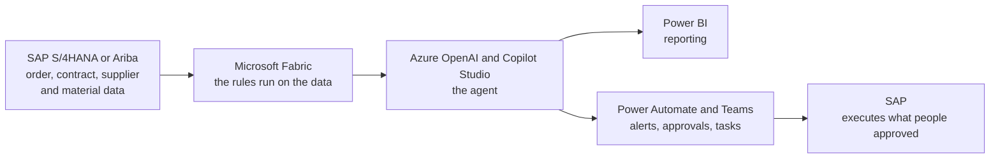

# Data Quality Agent

**Procurement data quality.** An AI agent that finds missing and contradictory procurement data, works out the root cause, who has to act and what it costs, and proposes costed ways to fix it for a person to decide.

Fictional company, no client data. You are interacting with an AI system: every action it prepares is a draft that waits for human approval, and nothing is ever sent.

> **Status: version 0.1.0, the first of three milestones.** The method, the fictional company's data and the page the agent will run on. The agent's runs, the board's rule states and the Simulation arrive in version 0.2, hardening and the release in 1.0. [PLAN.md](PLAN.md) is the build plan; [REVIEW.md](REVIEW.md) says what each milestone delivers.

Live site: <https://victorpflueger.github.io/PROC-data-quality/> (GitHub Pages, from `main`).

## What it does

GlobalCorp SE is the fictional industrial group of the [Rebate Hunter](https://github.com/VictorPflueger/PROC-Rebate-Hunter). Fifteen deterministic rules check its purchase-order lines, contracts, supplier and material master data over five data-quality dimensions: completeness, consistency, validity, uniqueness and timeliness. Accuracy is left out on purpose, because whether a value matches reality needs an outside check. Each exception is routed to the person who can fix it, its spend and financing cost are worked out, and it counts as closed only when a re-scan no longer finds it.

From version 0.2 the agent reads the records behind the findings, groups them by their root cause, lets the engine cost two or three fix paths next to doing nothing, waits for a decision and drafts the follow-ups and change requests. Two modes, chosen when a run starts: **Simulation** replays scripted runs offline and needs no key; **Live** runs the agent with your own Claude API key, kept for the browser tab only.

## What version 0.1.0 shows

- **The header** with the closure rate (the share of exceptions detected 14 to 69 days ago that a re-scan has closed), clean spend (the order lines with no live exception on the line, its supplier, material or contract) and open exceptions, as the exception log stands before a run, and the session cost.
- **The data-quality board:** the fifteen rules by data product, each with its dimension, severity and the person responsible, and the eight weekly closure cohorts as a table.
- **The console** with the agent's plan, the five steps of the progress rail and the tip of the chosen scenario: six scenarios, each a root cause planted in the data.
- **How it works**, with the production path below, and **Diagnostics**, which checks the security policy, the key handling and the integrity of the world's data in your browser.

Everything the page shows comes from the engine: `js/engine.js` (the rules, routing, clean spend, financing cost), `js/history.js` (the closure rate, cohorts, reconciliation with the log, projections), `js/fixpaths.js` (the fix paths and doing nothing), `js/figures.js` (the audit that keeps every figure the agent writes traceable) and `js/vat.js` (the VAT format rule). The same modules run in the browser and under Node, where the golden cases test them.

## The production path

In a production landscape the same steps would run on these products; the prototype stands in for all of them in one browser page.



## Run it

Open the live site, or serve this folder with any static web server and open it in a current Chrome or Edge:

```
python -m http.server 8000
```

then `http://localhost:8000`. Browsers block the page's modules when `index.html` is opened straight from disk; the loading screen says so. Nothing is installed and nothing is built: the page is HTML, CSS and JavaScript modules, and its data ship as three script files in `data/`.

The world is generated by `node tools/build_world.mjs` (seed 1911, the same bytes on every run) and checked by `node tools/check_world.mjs`.

## Tests

`node tests/run-all.mjs` runs every suite; [tests/README.md](tests/README.md) lists them and how to set up Playwright for the browser suites. GitHub Actions runs them on every push and pull request. No test calls a real API.

## Documents

- [TECH_NOTES.md](TECH_NOTES.md): verified facts with their dates, the security policy and storage, how the engine reads the method, the world's calibration, decisions and open points, the verification log and the acceptance checklist.
- [DATA_SOURCES.md](DATA_SOURCES.md): where every value comes from, the VAT formats and check-digit rules with their sources.
- [DESIGN.md](DESIGN.md): the look on Vici, the colour grammar and the checks behind it.
- [REVIEW.md](REVIEW.md): what was asked and built, and the shared shell.
- [PLAN.md](PLAN.md): the build plan.

## Sister prototypes

Built on the same shell and on [Vici](https://github.com/VictorPflueger/ViciDesign), Victor Pflüger's design system: [Rebate Hunter](https://github.com/VictorPflueger/PROC-Rebate-Hunter), [Navigator](https://github.com/VictorPflueger/supply-chain-navigator), [Timetable Translator](https://github.com/VictorPflueger/physicalAI-scheduler) and [Repack Pilot](https://github.com/VictorPflueger/physicalAI-repacking).
